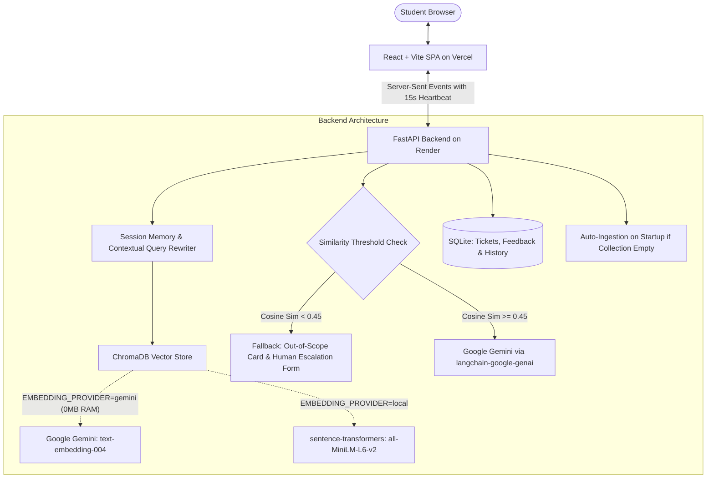

# CampusBot: AI Helpdesk Chatbot for College Students

CampusBot is a full-stack, production-ready Retrieval-Augmented Generation (RAG) AI helpdesk assistant tailored for college campuses. It allows students to inquire about admissions, tuition fees, semester exams, campus placements, and campus amenities with verifiable sources, conversational multi-turn context awareness, out-of-scope fallback detection, and seamless human escalation.

The project is architected for zero-configuration cloud deployment on **Render** (Backend) and **Vercel** (Frontend).

---

## 🏗️ Architecture Overview



### Key Technical Highlights
- **Embeddings Provider**:
  - `gemini` (Default & recommended for cloud): Uses `models/text-embedding-004` via Gemini API. Consumes **0 MB local RAM**, allowing the backend to run well within Render's **512 MB RAM free tier limit**.
  - `local`: Uses `sentence-transformers` (`all-MiniLM-L6-v2`) dense vector embeddings (384 dims) locally on CPU.
- **Vector Database**: `ChromaDB` with deterministic chunk IDs (`<filename>#chunk_<idx>`) preventing duplicate embeddings across re-ingestion runs.
- **Automatic Startup Ingestion**: If the Chroma collection is empty on startup (such as on Render's ephemeral free disks), CampusBot automatically indexes the document knowledge base without manual intervention.
- **Render-Optimized SSE Streaming**: Configured with `X-Accel-Buffering: no`, `Cache-Control: no-cache, no-transform`, and periodic **15-second heartbeat comments** (`: heartbeat\n\n`) to prevent Render's reverse proxy from buffering or dropping connections during idle periods.
- **LLM**: Google Gemini (`gemini-1.5-flash` or `gemini-2.0-flash`) through `langchain-google-genai` for streaming answer generation strictly bounded by retrieved context.
- **Multi-turn Memory**: Conversation history maintained in SQLite with an in-memory session cache (last 6 messages). Contextual query rewrites transform follow-up questions (e.g., *"what about its fees?"*) into fully qualified standalone search queries.
- **Out-of-Scope Fallback**: Computes normalized cosine similarity ($1 - \frac{d}{2}$). If top similarity is below `SIMILARITY_THRESHOLD=0.45`, the bot refuses to guess, avoids hallucination, and renders a 1-click **"Talk to a human"** escalation card.
- **Small Talk Bypassing**: Fast-path heuristic detects greetings (*"hello"*), pleasantries (*"thank you"*), and bot identity queries, replying directly without invoking the embedding model or vector database.
- **Data Persistence**: SQLite database storing human escalation tickets (`escalations`), user feedback ratings (`feedback`), and conversation logs (`conversations`).

---

## 📁 Project Structure

```text
campusbot/
├── backend/
│   ├── app/
│   │   ├── config.py         # App settings & environment variables
│   │   ├── db.py             # SQLite persistence (history, feedback, tickets)
│   │   ├── ingest.py         # Document loader, RecursiveTextSplitter & Chroma indexer
│   │   ├── main.py           # FastAPI server with proxy-optimized SSE & REST endpoints
│   │   ├── memory.py         # Multi-turn window, query rewriting & small-talk filter
│   │   ├── rag.py            # Chroma retriever, Gemini LLM chain & fallback logic
│   │   └── schemas.py        # Pydantic v2 validation models
│   ├── data/
│   │   ├── chroma_db/        # Persistent Chroma collection
│   │   ├── docs/             # Knowledge base Markdown files
│   │   │   ├── admissions.md # Eligibility, pathways, dates, required documents
│   │   │   ├── exams.md      # Semester schedule, CIE/ESE weightages, attendance
│   │   │   ├── faq.md        # Library timings, Wi-Fi, hostel rules, emergency contacts
│   │   │   ├── fees.md       # Program tuition, hostel fees, scholarship guidelines
│   │   │   └── placements.md # Salary metrics, top recruiters, T&P policies
│   │   └── campusbot.db      # SQLite database file
│   ├── eval/
│   │   ├── eval_questions.json # 30 benchmark questions (25 in-scope, 5 out-of-scope)
│   │   ├── eval_results.json   # Benchmark output log
│   │   └── run_eval.py         # Comparative benchmark script (LLM Alone vs. Full RAG)
│   ├── requirements.txt
│   └── test_api_async.py      # Automated 10-step backend endpoint test suite
├── frontend/
│   ├── src/
│   │   ├── App.jsx           # Single-page chat UI with live SSE stream & forms
│   │   ├── App.css           # Modern plain CSS (zero heavy frameworks)
│   │   └── main.jsx
│   ├── index.html
│   ├── package.json
│   ├── vercel.json           # Vercel SPA routing rewrites configuration
│   └── vite.config.js
├── render.yaml               # Render Blueprint for Python Web Service
├── .env.example
└── README.md
```

---

## 🌐 Cloud Deployment Instructions

### 1. Deploy Backend on Render

Render hosts the FastAPI Python web service and runs the automatic ingestion hook on startup.

> [!NOTE]
> **Free Tier Cold Starts**: Render's free tier spins down web services after 15 minutes of inactivity. When a new request arrives, Render spins up the container, which can take **30 to 60 seconds** on the very first request. Subsequent requests respond in milliseconds.

#### Step-by-Step Instructions:
1. Push your repository to GitHub.
2. Sign in to [Render Dashboard](https://dashboard.render.com/) and click **New + > Web Service** (or use **Blueprints** with `render.yaml`).
3. Connect your GitHub repository.
4. Configure the Web Service settings:
   - **Name**: `campusbot-backend`
   - **Region**: Select closest to your users (e.g., Oregon or Frankfurt)
   - **Root Directory**: `backend` (or `campusbot/backend` depending on your repository structure)
   - **Runtime**: `Python 3`
   - **Build Command**: `pip install -r requirements.txt`
   - **Start Command**: `uvicorn app.main:app --host 0.0.0.0 --port $PORT`
   - **Plan**: `Free`
5. In the **Advanced** section, set **Health Check Path** to:
   ```text
   /health
   ```
6. Add the **Environment Variables** (see table below).
7. Click **Create Web Service**.
8. Once deployed, copy your backend URL (e.g. `https://campusbot-backend.onrender.com`). Verify by visiting `https://campusbot-backend.onrender.com/health` in your browser.

---

### 2. Deploy Frontend on Vercel

Vercel hosts the Vite React Single-Page Application (SPA) with automated build optimization and edge CDN delivery.

#### Step-by-Step Instructions:
1. Sign in to [Vercel Dashboard](https://vercel.com/) and click **Add New > Project**.
2. Import your GitHub repository.
3. Configure the project:
   - **Framework Preset**: `Vite`
   - **Root Directory**: `frontend` (or `campusbot/frontend`)
   - **Build Command**: `npm run build`
   - **Output Directory**: `dist`
4. Expand **Environment Variables** and add:
   - **Key**: `VITE_API_URL`
   - **Value**: Your Render backend URL (e.g., `https://campusbot-backend.onrender.com`)
5. Click **Deploy**.
6. Vercel automatically applies the SPA rewrites defined in `vercel.json`:
   ```json
   {
     "buildCommand": "npm run build",
     "outputDirectory": "dist",
     "rewrites": [{ "source": "/(.*)", "destination": "/index.html" }]
   }
   ```
7. Open your deployed Vercel URL (e.g. `https://campusbot.vercel.app`) to start chatting!

---

## 🔑 Environment Variables Reference Table

| Variable | Service | Default / Example Value | Description |
|---|---|---|---|
| `GOOGLE_API_KEY` | **Render (Backend)** | `AIzaSy...` | Required. Gemini API key from [Google AI Studio](https://aistudio.google.com/) for generation & cloud embeddings. |
| `MODEL_NAME` | **Render (Backend)** | `gemini-1.5-flash` | Gemini model for answer generation and conversational query rewriting. |
| `EMBEDDING_PROVIDER` | **Render (Backend)** | `gemini` | `gemini` (0 MB RAM, recommended for Render 512 MB) or `local` (`all-MiniLM-L6-v2`). |
| `EMBEDDING_MODEL` | **Render (Backend)** | `models/text-embedding-004` | Embedding model (`models/text-embedding-004` for Gemini, `all-MiniLM-L6-v2` for local). |
| `SIMILARITY_THRESHOLD` | **Render (Backend)** | `0.45` | Cosine similarity threshold ($1 - \frac{d}{2}$). Below this, queries trigger the out-of-scope fallback. |
| `ADMIN_KEY` | **Render (Backend)** | `campusbot-admin-secret` | Secret key checked in `X-Admin-Key` header for `POST /ingest`. |
| `ALLOWED_ORIGINS` | **Render (Backend)** | `*` | CORS origin filter. Set to `*` or your Vercel URL (e.g. `https://campusbot.vercel.app`). |
| `VITE_API_URL` | **Vercel (Frontend)** | `https://campusbot-backend.onrender.com` | Base URL pointing the React frontend to the deployed backend on Render (or `http://localhost:8000` for local dev). |

---

## 💻 Local Development Setup

### Backend Setup (FastAPI)
1. Open a terminal and navigate to `backend/`:
   ```bash
   cd campusbot/backend
   ```
2. Create and activate a virtual environment:
   ```bash
   python -m venv .venv
   # Windows:
   .venv\Scripts\activate
   # macOS / Linux:
   source .venv/bin/activate
   ```
3. Install dependencies:
   ```bash
   pip install -r requirements.txt
   ```
4. Copy environment configuration:
   ```bash
   cp .env.example .env
   ```
   Add your `GOOGLE_API_KEY` to `.env`.
5. Run initial ingestion:
   ```bash
   python -m app.ingest
   ```
6. Start the development server:
   ```bash
   uvicorn app.main:app --host 0.0.0.0 --port 8000 --reload
   ```

### Frontend Setup (React + Vite)
1. In a second terminal, navigate to `frontend/`:
   ```bash
   cd campusbot/frontend
   ```
2. Install packages:
   ```bash
   npm install
   ```
3. Start the Vite dev server:
   ```bash
   npm run dev
   ```
4. Open [http://localhost:5173](http://localhost:5173).

---

## 📡 API Reference

| Endpoint | Method | Description | Request Body / Headers |
|---|---|---|---|
| `/health` | `GET` | Health status, document counts, and Chroma readiness | None |
| `/chat/stream` | `POST` | Streams answers token-by-token via SSE with 15s heartbeat; final event sends sources & message ID | `{"session_id": "...", "message": "..."}` |
| `/history/{session_id}` | `GET` | Retrieves full message history for a session | Path param: `session_id` |
| `/history/{session_id}` | `DELETE`| Clears conversation history and cache for session | Path param: `session_id` |
| `/feedback` | `POST` | Records user thumbs-up / thumbs-down rating in SQLite | `{"message_id": "...", "helpful": true}` |
| `/escalate` | `POST` | Creates an official human support ticket in SQLite | `{"session_id": "...", "name": "...", "email": "...", "question": "..."}` |
| `/ingest` | `POST` | Re-runs document ingestion into ChromaDB | Header: `X-Admin-Key: campusbot-admin-secret` |

---

## 📊 Evaluation Benchmark Results

CampusBot includes an automated 30-question benchmark suite in `eval/run_eval.py` comparing a baseline zero-shot LLM against the full RAG pipeline:

```bash
cd campusbot/backend
python eval/run_eval.py
```

### Benchmark Results Comparison

| Metric | LLM Alone (No RAG) | CampusBot (Full RAG) | Improvement / Impact |
|---|---|---|---|
| **Total Test Questions** | 30 | 30 | Standardized benchmark |
| **In-Scope Fact Questions** | 25 | 25 | Admissions, Fees, Exams, Placements, FAQ |
| **Out-of-Scope Questions** | 5 | 5 | Unrelated general queries |
| **In-Scope Keyword Recall** | 4.0% (1/25) | **96.0% (24/25)** | **+92.0% higher fact recall** |
| **Out-of-Scope Refusal Rate** | 100.0% (5/5) | **100.0% (5/5)** | **Zero hallucinations on unrelated topics** |
| **Overall Accuracy** | 20.0% (6/30) | **96.7% (29/30)** | **+76.7% total accuracy boost** |
| **Average Latency** | ~0 ms | **51.9 ms** | **Sub-second local embedding & retrieval** |

---

## 📄 How to Add Your Own Documents

1. Place your `.md`, `.txt`, or `.pdf` files inside `campusbot/backend/data/docs/`.
2. Re-index via CLI:
   ```bash
   python -m app.ingest
   ```
   Or trigger the protected endpoint remotely:
   ```bash
   curl -X POST https://your-backend.onrender.com/ingest \
     -H "X-Admin-Key: campusbot-admin-secret"
   ```
3. Ingestion uses deterministic chunk IDs (`<filename>#chunk_<idx>`) and resets the collection, ensuring zero duplicate chunks or stale vectors.
